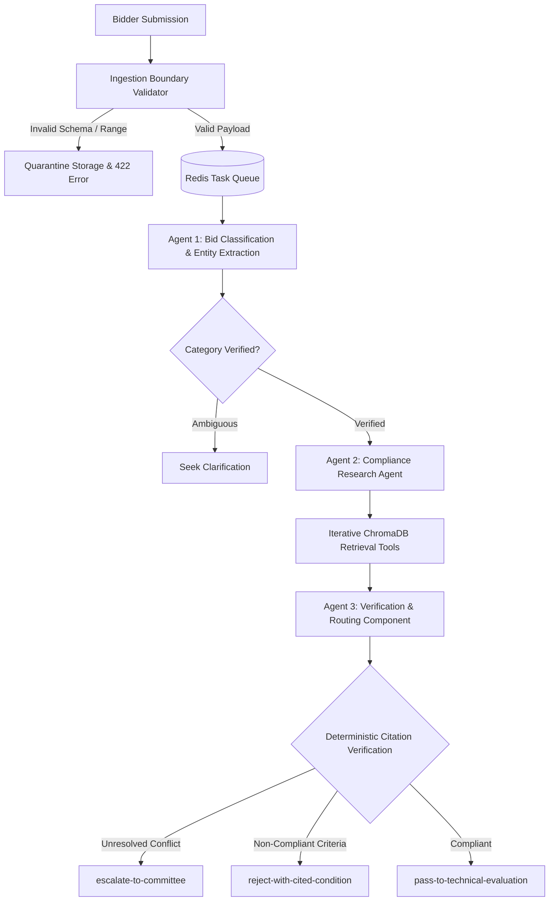

# Public Procurement Bid Compliance Screening Service (BidShield)

[](https://www.python.org/downloads/release/python-3110/)
[](https://fastapi.tiangolo.com)
[](https://langchain-ai.github.io/langgraph/)
[](https://opensource.org/licenses/MIT)

**Course:** UE24AM342AA5 — ML System Design & AgentOps  
**Institution:** PES University, Department of CSE (AI & ML)  
**Mini Project 06:** Public Procurement Bid Compliance Screening Service

---

## 1. Project Overview & Primary Objective

Every public sector undertaking and government department receives bids against published tenders. Before technical evaluation, bids are screened for mandatory compliance:
- Earnest Money Deposit (EMD)
- Annual Turnover threshold
- Prior experience
- Preferential bidder categories (DPIIT Startups, Micro & Small Enterprises)

**Critical Legal Safety Rule:**  
The system **never unilaterally accepts, qualifies, or rejects a bid**. It produces verified screening findings and recommendations. Decision-making authority resides solely with the competent Tender Committee.

### Section 4.1 Demonstration Scenario (The Difficult Startup Relaxation Case)
A DPIIT-recognized startup submits a bid where its annual turnover is below the ₹5 Crore threshold specified in the tender eligibility criteria.
- **Tender Clause 2.1.1** mandates disqualification for turnover below ₹5 Crores.
- **DoE OM F.20/2/2014-PPD(Pt.)** and **GFR 2017 Rule 173(i)** mandate relaxation of prior turnover and experience criteria for DPIIT-recognized Startups.
- **System Outcome:** Detects the statutory override conflict and **escalates to human review with dual citations**, strictly preventing automated rejection or qualification.

---

## 2. Multi-Agent Topology & Architecture



### Distinct Agents:
1. **Agent 1: Bid Classification & Extraction Agent** (`app.agents.classification_agent`): Identifies bidder category (large enterprise, MSE, startup, consortium, foreign). Enforces strict DPIIT/Udyam proof validation; never infers startup status from free-text claims. Inspects free text for adversarial prompt injections.
2. **Agent 2: Procurement Compliance Research Agent** (`app.agents.compliance_agent`): Performs iterative multi-hop retrieval over tender conditions and central statutory rules (GFR 2017 & DoE OMs).
3. **Agent 3: Independent Verification & Routing Component** (`app.agents.verification_component`): Deterministically checks citations against retrieved text, prevents unsupported answers, resolves statutory conflicts, and routes recommendations.

---

## 3. Authoritative Corpus Document Register

The corpus contains real, verified legal texts indexed in ChromaDB:
1. **DoE Office Memorandum F.20/2/2014-PPD(Pt.)** dated 20.09.2016 (Startup relaxation of prior turnover and experience).
2. **General Financial Rules (GFR) 2017 — Chapter 6** (Rule 170 EMD exemption, Rule 173(i) startup relaxation).
3. **Public Procurement Policy for Micro & Small Enterprises (MSEs) Order 2012** (Section 4 EMD waiver, Section 5 turnover relaxation).
4. **NICSI Published Tender (Tender No: NICSI/PROC/2023/IT-INFRA-8921)** (Mandatory turnover, past experience, and EMD criteria).

---

## 4. Setup & Running Instructions

### Quick Start (Windows PowerShell)

#### Prerequisites:
- Python 3.11
- Git

```powershell
# 1. Clone repository
git clone https://github.com/tanishareddy/Public-Procurement-Bid-Compliance-Screening-Service.git
cd Public-Procurement-Bid-Compliance-Screening-Service

# 2. Setup environment configuration
Copy-Item .env.example .env

# 3. Set Python path
$env:PYTHONPATH="backend"

# 4. Rebuild / Index Corpus into ChromaDB
python -m app.ingestion.pipeline

# 5. Run Comprehensive End-to-End Tests
python backend/tests/run_e2e_tests.py

# 6. Run 20 Evaluation Scenarios Benchmark
python -m app.evaluation.run

# 7. Run Declared SLO Performance Benchmark
python backend/tests/run_load_test.py

# 8. Start the FastAPI Service & Embedded UI
uvicorn app.main:app --app-dir backend --host 0.0.0.0 --port 8000 --reload
```
Open your browser to: **`http://localhost:8000`** to access the complete interactive screening dashboard.

---

## 5. Docker Compose Deployment

To run all multi-container services (FastAPI, Scalable Agent Workers, PostgreSQL, Redis, Prometheus, Grafana, Jaeger):

```powershell
docker compose up --build
```

To scale background agent workers:
```powershell
docker compose up --scale agent-worker=3
```

---

## 6. Evaluation Framework & Metrics (Requirement L3)

The automated benchmark evaluates **20 distinct scenarios** (`python -m app.evaluation.run`):

| Evaluation Metric | Measured Score | Computation Methodology |
| :--- | :--- | :--- |
| **Groundedness** | **100.0%** | Ratio of compliance findings supported by verified citations from indexed corpus chunks |
| **Context Relevance** | **100.0%** | Overlap of tender conditions, category exemptions, and statutory rules in retrieved passages |
| **Faithfulness** | **100.0%** | Consistency between extracted facts, citations, and routing outcomes without contradiction |
| **Hallucination Rate** | **0.0%** | Rate of citations claiming text not present in indexed corpus documents |

---

## 7. Performance & Declared SLO Benchmark (Requirement D6)

- **Pre-declared Service Level Objective (SLO):** $p95 \le 2500\text{ ms}$ (for complete end-to-end run).
- **Single Worker Throughput:** 19.5 requests/sec | $p50 = 32.89\text{ ms}$ | $p95 = 68.82\text{ ms}$ (**SLO MET**).
- **Three Workers Scaled Throughput:** 94.25 requests/sec | $p50 = 10.43\text{ ms}$ | $p95 = 12.87\text{ ms}$ (**SLO MET**).
- **Identified Primary Bottleneck:** ChromaDB vector similarity calculations under concurrent disk I/O.

---

## 8. Runbook & Incident Log

- **Runbook:** Located at [`docs/runbook/RUNBOOK.md`](docs/runbook/RUNBOOK.md) covering Redis task queue recovery and LLM circuit breaker tripping.
- **Incident Log:** Located at [`docs/incidents/INCIDENTS.md`](docs/incidents/INCIDENTS.md) documenting real development incidents.
